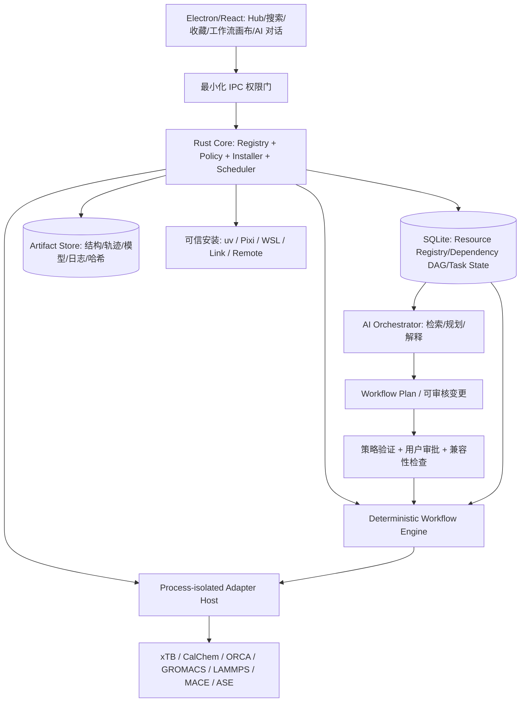

# MolForge Hub — 插件、AI 技能、科研工作流与模型统一生态

> 系统设计与工程行为指令 v0.2 · 2026-11-18  
> 状态：规划与验收规范，**不是已实现功能**。  
> 适用目标：Electron + React + TypeScript 前端，Rust 管理核心，隔离 Python Chemistry Bridge；可逐步迁移既有 MolForge Python/PyQt6 功能。  
> 前置文档：`MolForge_Extension_Hub_Architecture_v0.1.md`，此文是**增量扩展**，不覆盖前置软件安装规范。

## 1. 核心产品决策

1. **一个统一 Hub，四个资源分类**：Software & Plugins、Agent Skills、Scientific Workflows、Models & Assets；不用建四个彼此割裂的在线平台。
2. **一个统一能力注册表**：计算能力先有标准接口，插件/技能/工作流通过不可变 `capability_id` 关联，避免 UI/后端耦合。
3. **一个统一任务引擎**：按钮触发、自然语言触发、AI 规划、定时/批处理，都最终归并为可追溯 `WorkflowRun` / `JobRun`。
4. **渐进开放**：首版仅支持官方内置、经过审查的扩展包与本地导入；通过签名和供应链审核后再开放远程社区发布。
5. **科学正确性优先**：AI 解释与规划可以是非确定性的，科学执行必须有明确输入输出、软件环境、模型版本和日志；不得用 AI 生成的文字冒充数值计算结果。

## 2. 分层定义

| 资源 | ID 示例 | 主要组成 | 执行权限 |
|---|---|---|---|
| 软件/插件 Plugin | `org.molforge.gromacs` | 安装来源、版本、适配器、API、进程权限 | 精确声明且授权的外部能力 |
| AI 技能 Skill | `org.molforge.skill.md-rdf` | 标准 `SKILL.md`、参考文档、示例、可选脚本 | 默认仅说明；执行脚本另行审查与授权 |
| 工作流 Workflow | `org.molforge.workflow.md-rdf-v1` | 版本化有向图、节点参数、条件、依赖、断点、输出 | 由各节点声明权限并在执行前检查 |
| 模型 Model | `org.molforge.model.my-mlff` | 权重、SHA256、训练方法、适用元素/电荷/周期、许可证 | 数据资产，禁止未经审计反序列化执行 |
| 适配器 Adapter | `org.molforge.adapter.gmx` | `probe/prepare/run/parse/validate` 契约 | 进程隔离，明确目录与资源许可 |

### 关键区别

- Tool/Plugin 是“可以执行什么”；Skill 是“AI 应如何做”；Workflow 是“预先规定执行顺序”；Model 是“执行要加载的科学参数”。
- Agent 是把任务意图映射为 Skill + Workflow + Tools 的**编排者**，不是另一套任意代码执行机制。
- MCP 适合作为部分 AI 工具通信和发现协议；工作流图及模型库仍需 MolForge 自己的持久化格式。
- Agent Skills 的 `SKILL.md` 使用开放规范 `name`/`description` YAML 头与 Markdown 内容，不在该文件中伪造标准未定义的强制字段；MolForge 的扩展元数据与审计信息存独立 `molforge-manifest.yaml`。

## 3. 架构



**职责边界**
- React 只消费能力注册表并展示任务状态，不存科学事实与执行细节。
- Rust 负责依赖求解、权限审批、可恢复调度、环境与资源管理。
- Python/C++ 软件在受控子进程里执行。不能信任 `importlib` 插件动态加载 + `try/except` 即是安全隔离。
- AI 输出结构化、受 schema 验证的 `WorkflowProposal`，**不能直接任意执行 shell**。

## 4. 动态导航：取代几十个固定按钮

UI 只保留少量长期入口：`项目`、`工作台`、`Hub`、`任务`、`AI 助手`。其余从注册表动态生成。

### 单一搜索栏
按 `query + 当前文件格式 + 已安装能力 + 项目类型 + 最近使用` 搜索；首版采用关键词/标签与能力匹配，语义检索后续增加。显示“可运行”“需要安装依赖”“无法兼容”及原因。

### 用户自定义快捷入口
工作流可 `收藏`、`置顶`、`固定到工具栏`、`复制为我的工作流`。旧版按钮的一键运行体验仍保留，但无需编写新导航代码。

### 旧版迁移执行步骤
1. 列出旧导航中每个按钮、对应函数、输入、输出、外部工具、风险点、是否已经有回归测试。
2. 每个按钮映射为 `action`/`workflow`/`viewer`/`settings` 四种类型之一；只有真正的多步骤任务才转为 Workflow。
3. 用兼容适配层把已有工作函数注册成 `capability_id`，逐个添加输入输出 schema。
4. 为最常用 5～8 条工作流生成模板和快捷入口；逐条对照旧版测试输出，禁止无证据批量迁移。
5. 旧入口可在至少一个稳定版本周期内提供兼容导航；经用户确认后再逐步下线。

## 5. 技能系统：兼容 Agent Skills，按需检索

标准技能包结构：

```text
skills/
  md-rdf-analysis/
    SKILL.md             # Agent Skills 标准文件
    references/          # 科学解释、软件帮助、验证规则
    assets/              # 可选模板
    scripts/             # 可选；默认禁用自动运行，须单独审批
    molforge-manifest.yaml  # 非标准、MolForge 自有的安装/权限扩展元数据
```

`SKILL.md` 示例（仅指导，不是执行配方）：

```markdown
---
name: md-rdf-analysis
description: Use this skill when users analyze RDF in molecular dynamics trajectories, including PBC handling, atom-group definitions, and scientific interpretation.
---
# MD RDF analysis
1. Confirm trajectory, topology, periodic box, selected atom groups, and unit conventions.
2. Check equilibrated time range and group atom mapping.
3. Prefer capability `trajectory.rdf` with a supported engine.
4. Never present an unverified peak as an unambiguous pi-pi stacking assignment.
5. Save exact input hashes, group definition, units, and plot-generation script.
```

**技能加载策略**：只先索引元数据与关键词，用户请求命中时加载必要的 `SKILL.md` 和局部参考资料，避免把几十个完整技能一次注入模型上下文。技能文本可能包含恶意指令，必须当作低信任内容处理；绝不能通过文本覆盖权限、安全策略或强制用户审批。

## 6. 工作流数据结构与节点系统

使用独立 MolForge Workflow DSL（YAML/JSON，schema 校验、版本迁移、循环边界、DAG 校验）。与 n8n 等格式通过导入器转换，不依赖第三方格式作为内部唯一规范。

节点首版类型：`input`、`validate`、`transform`、`engine.run`、`analyze`、`visualize`、`conditional`、`approval`、`export`。第二阶段增加 `foreach`（有最大迭代/并行上限）、`remote.submit`、`agent.plan`。

示例（**设计提案**，不是 MolForge 已支持的语法）：

```yaml
schema_version: "molforge.workflow/v1"
id: org.molforge.workflow.md-rdf
version: 1.0.0
title: MD 轨迹 RDF 分析
inputs:
  trajectory: {type: file, extensions: [xtc, trr], required: true}
  topology: {type: file, extensions: [tpr, gro, pdb], required: true}
  group_a: {type: atom_selection, required: true}
  group_b: {type: atom_selection, required: true}
  time_window: {type: time_range, unit: ps}
requires:
  capabilities: [trajectory.rdf, plot.line]
steps:
  - id: validate
    type: validate
    rules: [input_exists, atom_map_consistent, box_valid, pbc_policy_defined]
  - id: rdf
    type: engine.run
    capability: trajectory.rdf
    depends_on: [validate]
    inputs: {trajectory: "$inputs.trajectory", topology: "$inputs.topology", groups: ["$inputs.group_a", "$inputs.group_b"], time_window: "$inputs.time_window"}
  - id: plot
    type: visualize
    capability: plot.line
    depends_on: [rdf]
    inputs: {series: "$steps.rdf.output"}
outputs: {rdf_data: "$steps.rdf.output", chart: "$steps.plot.output"}
```

**工作流设计规则**
- 每个节点的输入输出使用 JSON Schema + 科学单位、原子 ID 映射和化学语义扩展属性。
- 不允许静默更改科学分析定义。不同引擎实现同一个 capability，若结果含义不等价，应使用不同 schema 或 capability version。
- 容许缓存与断点续跑，但缓存键必须包括输入哈希、参数、引擎版本、模型权重、代码版本。
- 所有计算成功由真实返回码、软件收敛标志和结果校验共同决定；AI 推断不改变科学任务状态。
- 工作流支持“预览计划 / 缺失依赖 / 估计资源 / 审批 / 执行 / 重试 / 暂停 / 恢复 / 导出”。

## 7. AI 助手与技能/工作流的关系

用户示例：“对我的 PM6/BTP 共混模拟最后 20 ns 做 RDF，并比较两个端基排布的差异。”

1. Intent Router 提取候选任务 `trajectory.rdf`、`compare.rdf`，确认当前项目的数据文件是否齐全。
2. Capability Resolver 检查：当前系统是否有 GROMACS/MDAnalysis 适配器，是否支持原子组与 PBC。
3. Skill Retriever 加载 `md-rdf-analysis` 的说明和相关参考。
4. Workflow Planner 选择已验证模板；只有模板不适用时才提议生成新的草稿图。
5. Validator 检查轨迹/拓扑一致性、时间范围、组定义、单位、内存和输出目录。
6. 用户审核必要参数及可能改写的文件；无批准不运行有风险任务。
7. Deterministic Workflow Engine 执行，日志、输入快照、软件/技能/模板版本写入 provenance。
8. AI 对真实结果作解释，区分“直接计算得出”与“科学推断”，不编造缺失数值。

**默认三种模式**：
- 手动模式：用户自己选模板和参数。
- AI 辅助模式：AI 推荐模板、自动填参数草稿，执行前检查确认。
- 自动化模式：只运行用户明确批准过的参数化工作流，限定作用范围/资源预算/失败退出条件，不扩大权限。

## 8. 市场与安装流程

统一安装顺序：`Catalog → Dependency Resolver → Compatibility → License/Permission Preview → Download/Import → Verify → Staging → Smoke Test → Register → Ready`。

每个商品卡片显示：名称、作者、资源类型、版本、签名/来源、许可、已验证平台、所需工具、权限、依赖图、更新说明、使用示例。

- 安装 Workflow 仅保存模板，不代表所依赖软件已经安装。
- 安装 Skill 不代表赋予脚本或工具权限。
- 导入开源技能只说明格式可解析，**不表示安全可信**。
- 安装模型需要校验权重哈希、分发许可、元素覆盖、PBC/长程作用、训练域及运行依赖；反序列化应避免不受信任的任意 Python 对象。
- 商业软件采取 `Discover/Link` 或合法 Assisted 安装；不随 MolForge 重新打包其二进制程序。

## 9. 科研可复现与安全

`WorkflowRun` 至少保存：`run_id`、`workflow_id/version/hash`、`skill_ids/versions/hashes`、`capability_id/version`、`plugin/adapter`、`engine binary hash`、`model hash`、`environment lock hash`、输入文件哈希、参数、单位、选原子组与 atom mapping、输出哈希、原始日志、收敛状态、用户审批记录和时间戳。

安全实施：
- Third-party 代码在权限受控子进程中运行；高风险脚本要求额外审批，Rust 宿主采用最小权限。
- 安装源必须受信任，包锁定版本和校验哈希，市场目录与更新渠道有供应链审核。
- AI 不能通过 Skill 文本获得网络、文件、终端或外部账户的新权限。
- 访问密钥存系统安全凭据服务，不写入工作流 JSON、日志或共享模板。
- 避免安装卸载修改用户科研数据；数据删除及远程作业操作需要显式确认。

## 10. 模块建议

```text
apps/desktop/
  src/features/hub/                  # 统一发现、安装、升级、收藏与详情
  src/features/workflows/            # 工作流画布、运行面板、历史
  src/features/ai-assistant/         # 意图理解、技能发现、计划审核
crates/molforge-extension-registry/  # 资源与能力注册表
crates/molforge-dependency-solver/   # 可满足性检查与环境依赖
crates/molforge-workflow-engine/     # 确定性节点执行器
crates/molforge-skill-loader/        # Agent Skills 校验、按需加载
crates/molforge-security/            # 权限、凭据、签名与审计
crates/molforge-task-runtime/        # 进程隔离、Job 调度、恢复
crates/molforge-provenance/          # 科研溯源
adapters/                             # 各计算软件桥接层
catalog/                              # 官方审查 manifest/模板索引
schemas/                              # capability/workflow/resource schema
```

**语言选择说明**：保留 Python Chemistry Bridge 作为可替换的专用进程服务；不要强行把 RDKit/ASE/PyTorch/MDAnalysis 全改写为 Rust。迁移前应核对真实仓库与测试状态，而非根据 README 假设功能已就绪。

## 11. 里程碑与验收（按先后，不承诺工期）

- **P0 基线与抽象**：整理旧工作流按钮清单；定义 `capability`、`resource`、`workflow`、`job` 四个 schema；做到已有 Python 任务不被破坏。
- **P1 本地 Hub MVP**：本地预置目录；搜索、分类、收藏、安装状态；软件 Link 与能力探测；不必先建公开服务器。
- **P2 技能导入**：标准 `SKILL.md` 解析、合法 metadata 校验、技能检索、只读装载、来源/权限预览。
- **P3 工作流重构**：可执行版本化 DAG、任务日志、参数面板、基本图形编辑器；迁移 5 条真实旧按钮工作流。
- **P4 AI 闭环**：AI 从请求推荐 Skill 与 Workflow，填充参数草稿，执行审批与 provenance，禁止假成功。
- **P5 MLFF 与高级工作流**：MACE/ASE 模型管理、环境验证、推理任务与训练模板；远程 HPC 后续添加。
- **P6 社区生态**：可信发布、签名、审核、兼容性 CI、回滚、开发者 SDK；初期先支持 GitHub 来源导入并完整提示风险。

### P0-P4 最小验收用例
1. 同一功能从“旧导航按钮”、“搜索”与“AI 对话”进入，最终均使用同一 `capability_id` 与任务执行器。
2. 安装一个 RDF 工作流但未安装所需适配器时，显示缺失依赖且绝不假装可以运行。
3. 用户导入含恶意指令的 `SKILL.md`，不能因此获得超权限执行。
4. 用户取消任务后不损坏原始文件；任务失败记录真实错误、输入快照与可重试点。
5. 更换 MACE 模型权重后，历史任务记录仍指向旧权重 SHA256。
6. Windows 未安装 CUDA/WSL 时准确展示不兼容或 CPU 降级路径，不静默创建重型环境。
7. 五条已迁移的旧工作流在相同输入与分析定义下得到等价结果，差异按容差记录。

## 12. 可直接交给开发 Agent 的行为指令

> 角色：你是 MolForge Studio 首席软件架构师和科学计算工程师。
>
> 目标：基于现有公开代码与测试基线，增量构建可离线工作的统一 MolForge Hub，打通插件、Agent Skills、科研工作流和模型资产；优先迁移并验证旧导航的真实功能。
>
> 执行规则：
> 1. 审计仓库、列出已有能力及缺口；不得把 README 声称当作测试事实。
> 2. 先提交架构决策记录（ADR）、类型契约、接口 schema、威胁模型和迁移清单，经检查再实现 UI。
> 3. 小步提交，先实现注册表、权限边界、任务状态机，再实现市场 UI。
> 4. 为每个插件/技能/工作流设计版本化 manifest、依赖校验与卸载影响分析。
> 5. 必须写可自动运行的单元、集成、安装回滚和科学回归测试。
> 6. 不执行未知来源脚本；禁止无授权访问私有文件、安装系统级依赖或远程提交作业。
> 7. 每阶段提交：代码差异、构建测试日志、验收结果、未解决问题与回滚方式；用户现有项目/数据不被覆写。
> 8. 首个完整演示：从工作流市场选择 `MD 轨迹 RDF` → 发现/检查 GROMACS/MDAnalysis → 验证输入 → 获得用户审批 → 真正执行 → 输出图表与溯源记录。

## 13. 核对标准与借鉴来源（2026-11-18）

- Agent Skills specification: https://agentskills.io/specification
- Agent Skills 规范治理新闻（2026-10-22）：https://www.anthropic.com/news/donating-agent-skills-to-the-agentic-ai-foundation
- MCP documentation: https://modelcontextprotocol.io/
- n8n 工作流模板文档：https://docs.n8n.io/build/ways-of-building-workflows/use-templates/
- Dify Marketplace：https://marketplace.dify.ai/

> 这些是架构借鉴来源，并非声称各平台的代码可以直接复制、许可证兼容或其格式能无损互通。
