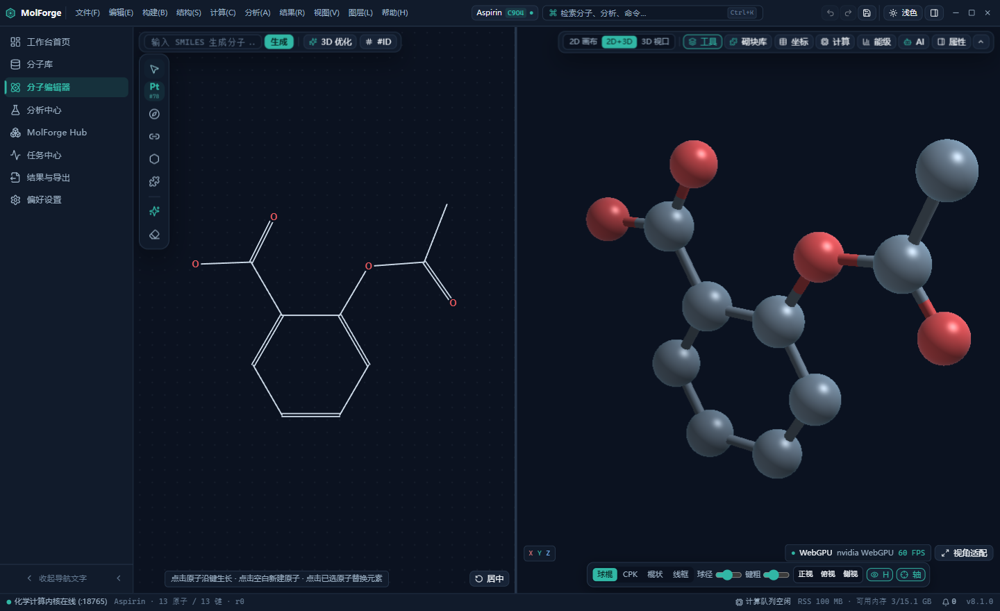
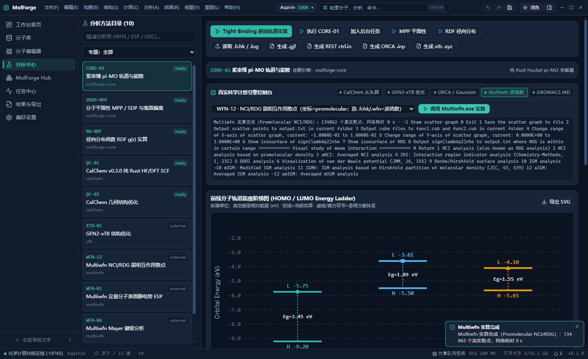

# MolForge Studio

**Lightweight AI-assisted Molecular Workbench for 2D/3D Structure Prep, Inspection & Local Engine Orchestration (Electron + WebGPU + Rust).**

[](./LICENSE)
[](https://github.com/yangdw2024/MolForge/releases)
[](https://pypi.org/project/molforge-studio/)
[](https://www.npmjs.com/package/@yangdw2024/molforge)

MolForge Studio (`v8.1.0`) is a lightweight desktop workbench focused on the practical front-half and orchestration steps of computational chemistry: drawing 2D molecules, inspecting synchronized 3D geometries via WebGPU, measuring internal coordinates, converting formats, preparing quantum-chemistry/MD input files, and dispatching local CLI calculations with clean provenance.

---

## Screenshots

| 2D Chemical Sketcher + Synchronized WebGPU 3D Viewport | Analysis Workbench (Multiwfn NCI/RDG & Frontier MO Ladder) |
| :---: | :---: |
|  |  |
| *Live 2D-to-3D split editor showing aspirin (`desktop/src/views/EditorView.tsx`, `Viewport3D.tsx`, `Molecule2DCanvas.tsx`).* | *Local Multiwfn 3.8 promolecular NCI/RDG run (`134,862` grid points) and tight-binding orbital ladder (`desktop/src/views/AnalysisView.tsx`).* |

---

## How MolForge Relates to My Other Chem Projects

To avoid feature overlap across repositories, each project in this ecosystem has a distinct scope:

| Repository | Scope & Positioning | When to Use It Instead of / Alongside MolForge |
| --- | --- | --- |
| [**MolForge**](https://github.com/yangdw2024/MolForge) *(this repo)* | **Lightweight molecular prep workbench & local orchestrator** (Electron 35 + WebGPU + Rust HTTP core) | Quick 2D/3D sketching, geometry inspection, SMILES/MOL/PDB/XYZ/GJF/CIF I/O, input-file prep, and launching local CLI tools. |
| [**CalChem**](https://github.com/yangdw2024/CalChem) | **Standalone native Rust/CUDA quantum chemistry solver** (`HF/DFT`, gradients, geometry opt, properties) | Standalone SCF/DFT calculation CLI/library without GUI overhead. MolForge optionally embeds CalChem via `--features calchem`. |
| [**WaveCraft**](https://github.com/yangdw2024/WaveCraft) | **High-performance 3D wavefunction & isosurface renderer** (Rust + React 19 / Three.js WebGL for Multiwfn 3.8) | Deep 3D volumetric orbital, ESP surface, and NCI isosurface visualization. |
| [**GROMACS-GUI**](https://github.com/yangdw2024/GROMACS-GUI) | **Full-lifecycle PyQt5 GROMACS MD toolkit** (system setup, EM, NVT/NPT, production, solvent evaporation, free energy, trajectory analysis) | End-to-end molecular dynamics simulations and full MD post-processing. MolForge only generates 5 starter `.mdp`/script files and quick pairwise RDF. |
| [**gaussian-dsh-plugin**](https://github.com/yangdw2024/gaussian-dsh-plugin) | **Dedicated Gaussian DSH plugin/helper** | Specialized Gaussian scripting and job workflows. |

---

## Implemented & Verified Features (Mapped to Source)

Every feature listed below is implemented in this repository and can be traced directly to its source files:

### Desktop Workbench (`desktop/`)
- **2D Chemical Sketcher & Periodic Table**: Atom/bond drawing, 118-element periodic table modal, right-click atom element/charge & bond-order context menus (`desktop/src/components/editor/Molecule2DCanvas.tsx`, `ChemicalToolRail.tsx`, `PeriodicTableModal.tsx`, `CanvasContextMenu.tsx`).
- **WebGPU 3D Viewport & Geometry Inspection**: Synchronized 3D rendering (`Ball & Stick`, `CPK`, `Stick`, `Wireframe`), orthographic/projection camera views (`Front`, `Top`, `Side`), and 2/3/4-atom distance, angle, and dihedral measurement (`desktop/src/components/editor/Viewport3D.tsx`, `desktop/src/views/EditorView.tsx`).
- **Floating HUD Utilities**: Fragment grafting library, Cartesian coordinates table, calculation input setup dialog, tight-binding orbital energy ladder SVG export, and an optional AI Copilot sidebar (requires user-provided API key; explicitly degrades to an offline mode notice when unconfigured) (`desktop/src/components/layers/FragmentsLayer.tsx`, `CoordinatesTableModal.tsx`, `CalculationSetupModal.tsx`, `OrbitalLadderModal.tsx`, `AiCopilotLayer.tsx`).

### Rust Core & Local Engine Adapters (`molforge-core/`)
- **Molecular Model, Undo Stack & Multi-Format I/O**: Pure-Rust molecule representation, undoable command dispatch, presets, binary scene framing, and parsers/writers for SMILES/JSON, `.xyz`, `.mol`/`.sdf`, `.pdb`, `.gjf`, and `.cif` (`molforge-core/crates/molforge-core/src/{model.rs,commands.rs,io.rs,presets.rs,binary.rs}`).
- **Built-in Lightweight Analyses**:
  - Tight-binding π-MO frontier orbital estimator (`CORE-01`) & heavy-atom least-squares plane planarity (`PROP-MPP` / MPP & SDP) (`molforge-core/crates/molforge-core/src/summary.rs`).
  - Pairwise Radial Distribution Function (`MD-RDF`) (`molforge-core/crates/molforge-core/src/engines.rs`).
  - 4-point organic semiconductor reorganization energy endpoint (`/api/qc/reorganization_energy`) (`molforge-core/crates/molforge-server/src/main.rs`).
- **Optional CalChem v0.3.0 Integration**: Compiled when built with `--features calchem` against a sibling `CalChem` workspace (`molforge-core/crates/molforge-core/src/qc.rs`), supporting `HF/RHF/UHF/RKS/UKS`, `B3LYP`, `B3LYP5`, `PBE`, `PBE0`, `BLYP`, `LDA/SVWN5`, `CAM-B3LYP`, `wB97X`, `wB97X-D`, and dipole magnitudes.
- **External CLI Wrappers** *(require user-installed local binaries)*:
  - **Multiwfn 3.8**: `WFN-12` (promolecular or wavefunction NCI/RDG) plus `WFN-01` (ESP), `WFN-06` (Mayer bond order), and `WFN-08` (ADCH charges; strictly requires a real `.fchk`/`.fch`/`.wfn`/`.wfx`/`.molden` wavefunction file) (`molforge-core/crates/molforge-core/src/engines.rs`).
  - **Gaussian / ORCA / REST / GFN2-xTB**: Input generation and local subprocess execution (`molforge-core/crates/molforge-core/src/engines.rs`).
  - **GROMACS Starter Templates**: Generates starter `minim.mdp`, `nvt.mdp`, `npt.mdp`, `md.mdp`, and `run_gmx.sh` via `/api/md/generate_gromacs` (`molforge-core/crates/molforge-server/src/main.rs`).
- **Local Job Queue & Workflow Provenance**: Sequential/background task tracking and reproducible workflow runs (`molforge-core/crates/molforge-core/src/{jobs.rs,workflow.rs,hub.rs}`, `desktop/src/views/{JobsView.tsx,HubView.tsx,AnalysisView.tsx}`).

> **Legacy v7.4.3 Branch**: The earlier PyQt6 implementation (`run_molforge.bat`) is preserved on branch [`legacy-v7`](https://github.com/yangdw2024/MolForge/tree/legacy-v7) and tag `v7.4.3`.

---

## Non-Goals & Roadmap

- **Explicit Non-Goals**: MolForge does **not** aim to replace full commercial ChemDraw suites, dedicated 3D volumetric/isosurface suites (use [WaveCraft](https://github.com/yangdw2024/WaveCraft)), full production MD GUIs (use [GROMACS-GUI](https://github.com/yangdw2024/GROMACS-GUI)), or standalone quantum chemistry solvers (use [CalChem](https://github.com/yangdw2024/CalChem)).
- **Planned / Roadmap**:
  - Cross-platform Linux/macOS prebuilt desktop releases alongside Windows x64 binaries.
  - Decoupling the optional `--features calchem` dependency from a local sibling path to a published crate / Git revision for turnkey CI builds.
  - Richer interactive chart inspectors for UV-Vis / TD-DFT and MD trajectory diagnostics.

---

## Quick Start

- **Windows Desktop Binaries (`v8.1.0`)**: Download `MolForge-Studio-8.1.0-win-x64-setup.exe` or `MolForge-Studio-8.1.0-win-x64-portable.exe` from [GitHub Releases](https://github.com/yangdw2024/MolForge/releases/tag/v8.1.0).
- **PyPI Launcher (`molforge-studio`)**:
  ```bash
  pip install -U molforge-studio
  molforge --status
  ```
- **npm CLI Wrapper (`@yangdw2024/molforge`)**:
  ```bash
  npx @yangdw2024/molforge --status
  npx @yangdw2024/molforge --server
  ```

### Local Development

```powershell
# 1. Rust core HTTP server (add `--features calchem` when sibling CalChem workspace is present)
cd molforge-core
cargo test
cargo build --release

# 2. Desktop frontend & Electron workstation
cd ../desktop
npm install
npm run typecheck
npm run lint
npm test
npm run pack:win
```

---

## 中文简介

**MolForge Studio (`v8.1.0`)** 是一款轻量级分子结构准备、三维检查与本地计算引擎调度工作台（**Electron 35 + React 19 + WebGPU + 纯 Rust 内核**）。

- **明确边界**：MolForge 聚焦于「2D 草绘 / 3D 构型检查 / 格式转换 / 输入文件生成与本地 CLI 工具调度」；若需要原生 Rust/CUDA 量子化学求解引擎请使用 [CalChem](https://github.com/yangdw2024/CalChem)，需要高性能三维波函数/等值面渲染请使用 [WaveCraft](https://github.com/yangdw2024/WaveCraft)，需要完整 GROMACS 动力学全流程请使用 [GROMACS-GUI](https://github.com/yangdw2024/GROMACS-GUI)。
- 原 PyQt6 `v7.4.3` 代码（含 `run_molforge.bat`）已完整归档于 `legacy-v7` 分支与 `v7.4.3` 标签。

---

## License

Licensed under the [Apache License, Version 2.0](./LICENSE). Copyright 2026 MolForge Team (yangdw2024).
